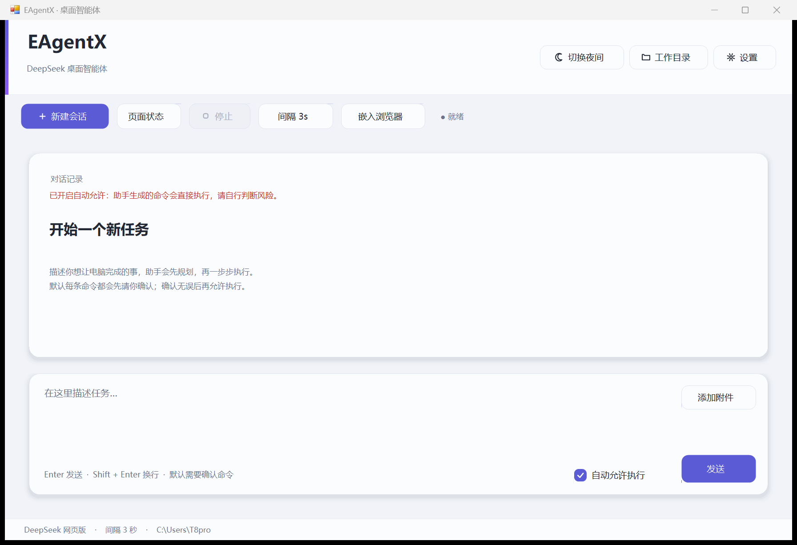
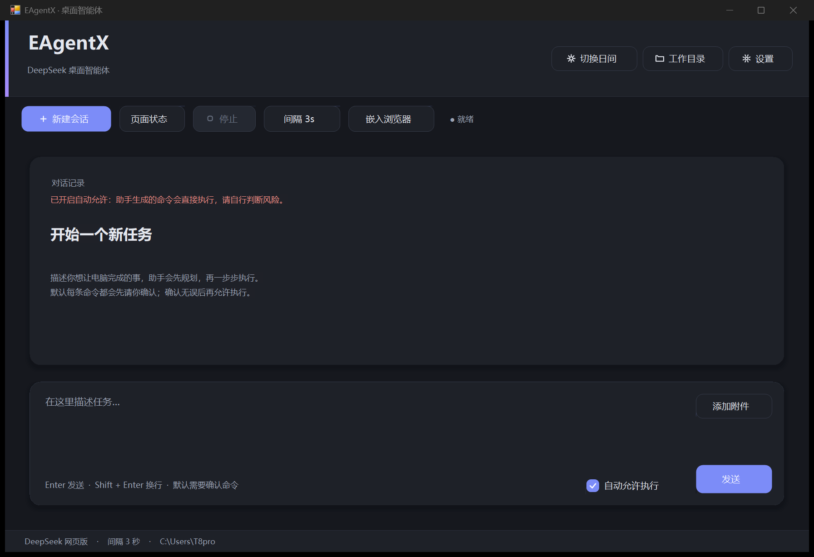

# EAgentX

日间浅色 / 夜间深色双主题、卡片式界面的 Windows 桌面智能体。

> **本项目基于 [YaoGaoChaoLe/EAgent](https://github.com/YaoGaoChaoLe/EAgent) 制作。**
> EAgent 是原作者用易语言写的开源项目，本仓库是它的 **C# / .NET Framework 重写版**，
> 沿用「思考 → 执行 → 观察 → 再思考」的闭环思路与 CDP 网页驱动方案，
> 并重做了整套界面、补上命令审批与技能库等能力。致原作者 YaoGaoChaoLe。

功能上你写一句任务，模型给出 PowerShell 命令，程序执行后把**真实输出**回喂给模型，
形成 `思考 → 执行 → 观察 → 再思考` 的闭环 —— 全程走 DeepSeek 网页版，**不需要 API Key**。

当前构建：`dist\EAgentX.exe`，616,960 字节，SHA-256
`257168088C4D983C693FE2E686CA362F2C42AE68D4179F0DB61523792BED78F8`（0 警告 0 错误；`--selftest` 22/22）。

日间主界面：



夜间主界面：



设置窗口：[日间](docs/ui-theme-settings-light.png) / [夜间](docs/ui-theme-settings-dark.png)；
发送间隔弹窗（含遮罩）：[夜间](docs/ui-theme-delay-dark.png)。

主题 / 美化实现细节、改动清单和"怎么改配色"见 [`docs/UI美化升级说明.md`](docs/UI美化升级说明.md)。

## 与原作的隔离

本项目是独立发行的一份实现，与你机器上可能存在的其它版本互不干扰。

| 项目 | 本项目 |
|---|---|
| 可执行文件 | `dist\EAgentX.exe` |
| 配置 / 日志 | `%APPDATA%\EAgentX-UI` |
| 浏览器 profile | `%APPDATA%\EAgentX-UI\edge-profile` |
| CDP 默认端口 | `9555` |
| 单实例 Mutex | `EAgentX.UI.SingleInstance.5C8A72` |

## 界面变化

- **双主题**：日间浅色（冷灰底 + 米白卡片）/ 夜间深色（深灰蓝底 + 深灰卡片），右上角一键切换，
  280ms 淡入淡出，选择自动存到 `%APPDATA%\EAgentX-UI\theme.json`，下次启动沿用；首次启动默认浅色。
- 两套配色都避开纯黑纯白，降低大面积对比，适合长时间挂机看数据。
- 圆角 16 / 10 / 6 三档统一；间距 4/8/12/16/24/32 统一；字号 27/19/15/14/13/12/11 分级。
- 卡片带柔和落影，三层视觉层次：页面底 → 卡片 → 悬浮弹窗。
- 按钮四种状态（常态/悬浮/按下/禁用）都有补间过渡；主 / 次要 / 危险三种配色分开。
- 输入框改成圆角描边，聚焦变强调色、校验失败变红边；数字框、下拉框、复选框、页签、滚动条全部自绘。
- 线性图标（月亮/太阳、文件夹、齿轮、加号、停止）跟随主题变色。
- 弹窗居中 + 半透明遮罩，点遮罩即取消；系统 MessageBox 换成跟随主题的自绘消息框。
- 悬浮提示气泡替代系统黄色 tooltip；日志长行悬浮可看整行。
- 全尺寸按 DPI 等比缩放（100% / 125% / 150% 都不错位），窗口初始尺寸受屏幕工作区约束。
- 顶部只保留品牌、副标题、主题切换、工作目录和设置；功能操作放下方工具栏。

## 功能

- 网页版 DeepSeek 驱动：连接浏览器里的网页会话，不需要 API Key；也支持 OpenAI 兼容 API。
- PowerShell 执行、截图 / 文件 / 鼠标 / 键盘工具、技能库、浏览器嵌入、随机发送间隔。
- 默认每条命令都要确认；可在设置里关闭确认或关闭扩展工具。

## 运行

```powershell
git clone https://github.com/yrtnb666/EAgentX.git
cd EAgentX
powershell -NoProfile -ExecutionPolicy Bypass -File .\build.ps1
.\dist\EAgentX.exe
```

首次启动会用新的浏览器 profile（`%APPDATA%\EAgentX-UI\edge-profile`），需要重新登录 DeepSeek。
之后登录状态跟着 profile 走，不用重复登录。

## 构建与自检

```powershell
# Windows 自带 C# 5 编译器
powershell -NoProfile -ExecutionPolicy Bypass -File .\build.ps1 -Csc "$env:WINDIR\Microsoft.NET\Framework64\v4.0.30319\csc.exe"

.\dist\EAgentX.exe --selftest
.\dist\EAgentX.exe --shotcheck
```

源码保持 C# 5，Windows 自带 `csc.exe` 和 Roslyn 两条链路都能编译，零警告。详细说明见
[`docs/UI版说明.md`](docs/UI版说明.md)，技能清单见 [`docs/技能包清单.md`](docs/技能包清单.md)。

## 致谢与出处

- **原作：[YaoGaoChaoLe/EAgent](https://github.com/YaoGaoChaoLe/EAgent)**（易语言，GPL-3.0）
  本项目是它的 C# 重写版，核心思路、CDP 网页驱动方案与提示词结构均源自原作。
  原作作者 YaoGaoChaoLe 提供了最初的设计思路与工具协议，本项目在此基础上重写实现。
  完整对比见 [`docs/与EAgent对比.md`](docs/与EAgent对比.md)，原作 README 存档见
  [`docs/原作者README.md`](docs/原作者README.md)。
- **下游项目：[yrtnb666/SnapAsk](https://github.com/yrtnb666/SnapAsk)** 复用了本项目的 CDP 网页驱动方案。

## License

本项目基于 [YaoGaoChaoLe/EAgent](https://github.com/YaoGaoChaoLe/EAgent)（GPL-3.0）重写，
按 GPL-3.0 发布，仅供学习交流，不提供任何担保。完整条款见 [LICENSE](LICENSE)。

原作声明同样适用：EAgent 不是反代、没第三方中转、没逆向 DeepSeek 网页，
但**基于 CDP 自动化操控网页，同样违反了 [DeepSeek 用户协议](https://cdn.deepseek.com/policies/zh-CN/deepseek-terms-of-use.html)**，
请自行评估账号风险。
